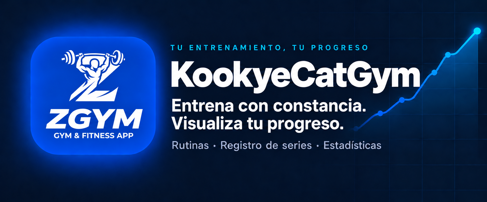

<p align="center">
  
</p>

<h1 align="center">KookyeCatGym</h1>

<p align="center">
  <strong>Tu entrenamiento, tu progreso.</strong><br>
  Crea tus rutinas, registra cada serie y descubre cómo mejoras.<br>
  Una app web autoalojable y multiusuario para llevar tu gimnasio contigo.
</p>

<p align="center">
  <a href="LICENSE"></a>
  <a href="public/manifest.json"></a>
</p>

<p align="center">
  
  
  
  
  
  
</p>

<p align="center">
  <a href="#requisitos">Instalación</a> ·
  <a href="server/README.md">Guía del backend</a> ·
  <a href="https://github.com/DavidJLlanes/kookyecatgym/issues">Reportar un problema</a> ·
  <a href="LICENSE">Licencia</a>
</p>

---

## Qué puedes hacer

| | |
| --- | --- |
| 🏋️ **Rutinas a tu medida** | Más de 5.600 ejercicios con vídeo, rutinas en carpetas, superseries y circuitos, pirámides, descansos por serie, ejercicios de repuesto y planes de iniciación (PPL, torso/pierna, cuerpo completo, 5×5). |
| 🔁 **Rotación y plan semanal** | Rotación de sesiones (A, B, C…) o días fijos; mueve una sesión de día solo esa semana y planifica semanas de descarga. |
| 📝 **Registro de entrenamientos** | Series, repeticiones, peso, RPE, cardio por tiempo y distancia, reps por lado, deslizar para borrar o copiar series, y editar o registrar entrenamientos pasados. |
| 🧱 **Tipos de serie** | Calentamiento, drop set, rest-pause y fallo, cada uno con su menú y su letra en la tabla de series. |
| 🗂️ **Sesión en dos vistas** | Durante el entrenamiento alterna entre tarjetas (todas las series a la vista) y lista compacta (resumen y próxima serie); un único menú «⋯» por ejercicio con historial, repeticiones por lado, superserie, alternativas y quitar. |
| ⏱️ **Ejercicios por tiempo que arrancan solos** | Planchas, colgados y demás ejercicios de mantener: «Cronometrar serie» da una cuenta atrás de preparación (5 s), cronometra el aguante, marca la serie sola y arranca el descanso; con «auto» encadena todas las series. |
| 📋 **Programas de varias semanas** | Tres programas propios (fuerza en olas, cuerpo completo para hipertrofia y 5×5 lineal): apuntas tu máximo de entrenamiento y la app calcula la carga de cada sesión según la semana, con descarga incluida; cuando terminas, «repetir con más carga» sube los máximos. |
| ⚖️ **Progresión** | Lineal, doble, Greyskull y triple (repeticiones → series → carga), con pila de pesas real de cada máquina. |
| 📈 **Progreso visible** | 1RM estimado, historial de cada ejercicio, mapa muscular (volumen, recuperación, sin entrenar), peso corporal frente a un objetivo y fuerza relativa. |
| 🍎 **Nutrición** | Calcula tu metabolismo basal (Mifflin-St Jeor), gasto diario y objetivo de calorías y macros (distinto en días de entreno y descanso); diario por comidas con ~110 alimentos básicos y los tuyos, agua, resumen semanal y exportación a CSV. Con una clave de IA configurada (la del Coach) añade: recetas con los alimentos que tengas, estimar una comida escrita, plan semanal con lista de la compra y análisis de la semana. Las cifras son aproximadas y no sustituyen a un profesional. |
| 🗺️ **Mapa muscular por todas partes** | Mini mapa de lo que trabaja cada sesión en «Te toca», el plan semanal, las tarjetas de rutina y el editor (en directo mientras añades ejercicios); hoja de «Músculos de la sesión» con lo planeado frente a lo hecho; buscador de ejercicios tocando un músculo en la biblioteca; y «Por músculos»: tocas los que quieres trabajar y se arma la sesión con tu equipamiento, tus favoritos y lo que ya has hecho. |
| 💪 **Fuerza relativa con historial** | Tu 1RM de cada ejercicio como múltiplo y como % del peso corporal del día en que lo hiciste, con su evolución en el tiempo, el total levantado acumulado y objetivos ATG en % de tu peso. |
| 🧭 **Balance estructural por fuentes** | Ratios entre levantamientos agrupados por origen, con su atribución en pantalla: Poliquin, clásicos (OPEX) y rangos generales. Ver [Balance estructural](#balance-estructural-y-sus-fuentes). |
| 📅 **Constancia** | Calendario y mapa de actividad. |
| 🤖 **IA para tus consejos** | Coach IA integrado con tu propia clave de API (OpenRouter, Gemini, Groq, Cerebras, Mistral, Anthropic, OpenAI o DeepSeek; OpenRouter y Gemini tienen opciones gratuitas), resumen para pegar en cualquier IA y un [servidor MCP](mcp/README.md) de solo lectura. |
| 📤 **Tus datos, tuyos** | Exporta a CSV o JSON, importa desde Hevy, Strong o FitNotes, y comparte planes como archivo o PDF. |
| 🧮 **Calculadoras de carga** | Calculadora de discos por lado según el material que tengas y editor de pilas de pesas por máquina. |
| 🎬 **Tus propios medios** | Sustituye el vídeo o la foto de cualquier ejercicio por los tuyos, y añade fotos de progreso al calendario. |
| 🔔 **Descansos con aviso** | Notificaciones push cuando termina el descanso entre series, aunque la app esté en segundo plano. |
| 📶 **Sin conexión** | Service worker y PWA instalable: la app sigue abriendo y mostrando tus datos sin red. |
| 🔐 **Cuentas seguras** | Inicio de sesión con contraseña o passkeys (Face ID, Touch ID, huella, Windows Hello), sin depender de librerías externas. |
| 🔀 **Sincronización entre dispositivos** | Fusión de cambios a tres vías, para que dos dispositivos editando a la vez no se pisen. |
| ⚠️ **Avisos de datos raros** | Detección de anomalías en tus registros: marca valores que probablemente sean errores de tecleo. |
| 🔠 **Accesible** | Tamaño de letra ajustable y diseño probado de 320 a 430 px de ancho. |
| 🖼️ **Tarjetas para compartir** | Genera tarjetas de tus entrenamientos y resultados para redes, o pega el resumen como pegatina sobre una foto tuya (la arrastras, cambias su tamaño y exportas 1080×1350). |
| 🔍 **Comparador de fotos** | Fotos de progreso por músculo con vista lado a lado o con un deslizador antes/después. |
| 🧩 **Combinador de rutinas** | Combina varias rutinas en un mismo plan de días. |
| 🛠️ **Administración** | Panel para administradores con estadísticas, registro de auditoría, ajustes y control de altas de usuarios. |
| 🏠 **Tu propio servidor** | Aloja la app con React, PHP y SQLite, con soporte multiusuario. |

> El repositorio incluye el catálogo de ejercicios con sus vídeos e imágenes
> (`public/exercises/`, unos 190 MB) y las imágenes anatómicas por zona muscular
> (ver [Imágenes](#imágenes)).

## Estructura del código

```
src/
├── AppContent.tsx            Orquestador (~300 líneas): une los hooks y reparte datos a las pestañas
├── components/
│   ├── app/                  Cabecera, navegación (escritorio/móvil), pestaña Entrenar (banner, historial),
│   │                         copia de seguridad, celebración al terminar, entrenamiento aleatorio
│   ├── workout/              Entrenamiento en curso: panel, cabecera, tarjeta/lista, menú, tabla de series,
│   │                         temporizadores de descanso y de series por tiempo
│   ├── routines/             Rutinas: tarjeta, carpeta, editor (con una fila por ejercicio) y modal de carpeta
│   ├── progress/             Progreso: una tarjeta por componente (resumen, ranking, récords, 1RM...) y las
│   │                         pestañas Músculos y Progresión
│   ├── library/              Biblioteca: filtros, tarjeta, ficha del ejercicio y creación de ejercicios
│   ├── body/                 Fotos de progreso físico: comparador antes/después, edición, medidas
│   ├── nutrition/            Nutrición: diario, comidas, agua, alimentos, objetivos y resumen semanal;
│   │                         ai/ con las herramientas de IA (recetas, estimar, plan, análisis)
│   ├── muscle/               Mapa muscular: silueta, mini mapa, explorador, balance, sesión por músculos
│   ├── stats/                Fuerza relativa con historial y estándares ATG
│   ├── programs/             Tarjeta del programa en marcha y selector de programas
│   └── share/                Pegatina del entrenamiento sobre una foto
├── hooks/
│   ├── useGymData            Datos del usuario: carga inicial, guardado con fusión de tres vías, sincronización
│   ├── useActiveWorkoutStore Entrenamiento activo: guardado con retardo y borrado fiable
│   ├── useWorkoutSession     Empezar (libre, por músculos, aleatorio, rutina), finalizar y cancelar
│   ├── useLibraryActions     Altas, bajas y cambios de rutinas, ejercicios propios e historial
│   ├── useMediaActions       Subir, actualizar y borrar fotos y vídeos
│   ├── useDataTransfer       Copia JSON, exportación CSV, restauración e importación de otras apps
│   ├── useRoutineFolders     Carpetas de rutinas y su orden
│   ├── useLibraryFilters     Filtros de la biblioteca y carga por lotes
│   ├── useProgressStats      Estadísticas globales de Progreso
│   ├── useNutritionData      Perfil, alimentos propios y diario de Nutrición
│   ├── useNutritionAi        Peticiones a la IA de Nutrición y disponibilidad de la clave
│   ├── useNutritionTargets   Objetivos del día según peso reciente y día de entreno
│   └── …                     Temporizadores, pantalla activa, preferencias locales, diálogo de confirmación
├── utils/                    Lógica pura (sin React) y sus tests en utils/__tests__
│   └── shareCards/           Tarjetas compartibles dibujadas en canvas (entrenamiento y progreso)
└── data/                     Catálogo, base de alimentos, geometría del cuerpo, planes de iniciación y programas
```

Criterio: un componente por responsabilidad, la lógica que no necesita React en `utils/` como
funciones puras (se prueban con `npm test`), y el estado con efectos (guardado, temporizadores,
sincronización) en hooks. Ningún fichero de la aplicación pasa de ~500 líneas salvo catálogos de datos.

## Balance estructural y sus fuentes

Los ratios se calculan con tu mejor 1RM estimado (Epley, series de hasta 12 repeticiones, últimos 6 meses)
y solo se muestran cuando hay datos en ambos lados. Cada pestaña dice de dónde sale:

- **Poliquin** (smartraining.substack.com, «basados en las enseñanzas de Poliquin»): pectoral = dorsal 1:1,
  isquiotibiales ≈ 75 % del cuádriceps y bíceps ≈ 60-70 % del tríceps. El cuarto ratio de esa fuente
  (rotadores externos/internos del hombro) no se calcula porque la biblioteca no tiene ejercicios comparables.
  La fuente da el valor; el margen en torno a 1:1 (±10 %) y al 75 % (±0,05) lo añade la app.
- **Clásicos (OPEX Fitness)**: peso muerto ≈ 125 % de la sentadilla trasera y sentadilla frontal ≈ 85 %
  (margen alrededor de esos valores añadido por la app).
- **Rangos generales**: referencias habituales sin una fuente única.

Los **estándares ATG** (peso muerto rumano con barra al 100 % del peso corporal ×10, press inclinado con
mancuernas al 33 % por mancuerna ×10 y gemelo a una pierna con mancuerna al 25 % ×10) provienen de la compilación
de a1athlete.com a partir de Ben Patrick; no es una lista oficial.

## Requisitos

- Node.js 18+ y npm
- PHP 8+ con la extensión PDO SQLite (para el backend)
- Node.js 22.5+ solo si vas a usar el servidor [MCP](mcp/README.md)

## Frontend

```bash
npm install
npm run dev        # servidor de desarrollo en http://localhost:3000
npm run build      # genera dist/ para producción
npm run preview    # sirve el build de producción localmente
npm run lint       # comprobación de tipos (tsc --noEmit)
npm test           # tests de la lógica pura (vitest)
```

Configura la URL de la API copiando `.env.example` a `.env`:

```
VITE_API_BASE=/api          # o https://tu-dominio.com/api
```

Si no se define, por defecto usa `/api` (mismo origen).

## Backend (PHP + SQLite)

El backend está en [`server/`](server/). Súbelo a tu hosting y sírvelo bajo la
ruta que uses como `VITE_API_BASE` (p. ej. `https://tu-dominio.com/api`). La
base de datos SQLite se crea sola en el primer arranque.

Configúralo mediante variables de entorno del servidor (no son variables de
Vite):

| Variable | Descripción |
|---|---|
| `APP_ALLOWED_ORIGINS` | Dominios permitidos por CORS, separados por comas. |
| `APP_DB_PATH` | Ruta de la BD SQLite. **Debe estar fuera del web root** (contiene emails, hashes y tokens). Por defecto `../../app_data/gym.db`. |
| `ADMIN_USERNAME` | Usuario del administrador inicial (por defecto `admin`). |
| `ADMIN_EMAIL` | Email del administrador inicial. |
| `ADMIN_PASSWORD_SHA256` | Hash SHA-256 de la contraseña de admin. Si no se define, se usa `changeme`: **cámbialo de inmediato.** |

> Seguridad: nunca dejes el fichero `.db` dentro del directorio público, o
> cualquiera podría descargarlo.

## Imágenes

Los medios del catálogo **sí están incluidos**: el catálogo (`src/data/catalog.json`)
apunta a estos nombres, donde `<id>` es el número del ejercicio (p. ej. `0025`):

- `public/exercises/clip/<id>.mp4` — vídeo corto de cada ejercicio
- `public/exercises/still/<id>.webp` — fotograma estático (miniatura)
- `public/muscle-anatomy/<zona>.webp` — imágenes anatómicas por zona muscular (25 archivos, una por zona)

Lo siguiente **no** se incluye y se añade aparte en `public/`:

- `public/user-photo.webp` — foto opcional del usuario para las tarjetas
  (si falta, la tarjeta se genera sin foto)

Las animaciones e imágenes de ejercicios pertenecen a sus creadores originales
(p. ej. ExerciseDB / GymVisual) y se rigen por sus propias licencias.

## Créditos y licencias de terceros

- Geometría del mapa muscular: adaptada de [MuscleMap](https://github.com/melihcolpan/MuscleMap) (MIT).
- Todo lo añadido para este proyecto (programas, ratios, pegatina, comparador, mapa en la sesión) está escrito
  desde cero; no se ha copiado código de otras apps de entrenamiento cuyas licencias (GPL/AGPL) no son
  compatibles con la de este repositorio.

## Licencia

Código bajo licencia [CC BY-NC-ND 4.0](LICENSE): puedes usarlo y compartirlo citando al autor, **sin fines comerciales y sin modificarlo**. Las imágenes/animaciones de ejercicios
quedan excluidas de dicha licencia (pertenecen a sus autores originales).
