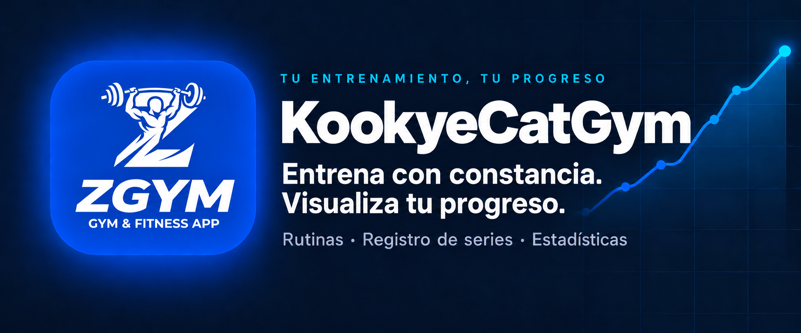

<p align="center">
  
</p>

<h1 align="center">KookyeCatGym</h1>

<p align="center">
  <strong>Tu entrenamiento, tu progreso.</strong><br>
  Crea tus rutinas, registra cada serie y descubre cómo mejoras.<br>
  Una app web autoalojable y multiusuario para llevar tu gimnasio contigo.
</p>

<p align="center">
  <a href="LICENSE"></a>
  <a href="public/manifest.json"></a>
</p>

<p align="center">
  
  
  
  
  
  
</p>

<p align="center">
  <a href="#requisitos">Instalación</a> ·
  <a href="server/README.md">Guía del backend</a> ·
  <a href="https://github.com/DavidJLlanes/kookyecatgym/issues">Reportar un problema</a> ·
  <a href="LICENSE">Licencia</a>
</p>

---

## Qué puedes hacer

| | |
| --- | --- |
| 🏋️ **Rutinas a tu medida** | Organiza tus ejercicios y prepara cada sesión. |
| 📝 **Registro de entrenamientos** | Guarda series, repeticiones y pesos. |
| 📈 **Progreso visible** | Consulta estadísticas y tu 1RM estimado. |
| 📅 **Constancia** | Revisa tu actividad en el calendario de entrenamientos. |
| 🖼️ **Tarjetas para compartir** | Genera tarjetas de tus entrenamientos y resultados para redes. |
| 🏠 **Tu propio servidor** | Aloja la app con React, PHP y SQLite, con soporte multiusuario. |

> Este repositorio contiene **solo el código**. Las animaciones de ejercicios
> y las imágenes anatómicas **no se incluyen** (ver [Imágenes](#imágenes)).

## Requisitos

- Node.js 18+ y npm
- PHP 8+ con la extensión PDO SQLite (para el backend)

## Frontend

```bash
npm install
npm run dev        # servidor de desarrollo en http://localhost:3000
npm run build      # genera dist/ para producción
npm run preview    # sirve el build de producción localmente
npm run lint       # comprobación de tipos (tsc --noEmit)
```

Configura la URL de la API copiando `.env.example` a `.env`:

```
VITE_API_BASE=/api          # o https://tu-dominio.com/api
```

Si no se define, por defecto usa `/api` (mismo origen).

## Backend (PHP + SQLite)

El backend está en [`server/`](server/). Súbelo a tu hosting y sírvelo bajo la
ruta que uses como `VITE_API_BASE` (p. ej. `https://tu-dominio.com/api`). La
base de datos SQLite se crea sola en el primer arranque.

Configúralo mediante variables de entorno del servidor (no son variables de
Vite):

| Variable | Descripción |
|---|---|
| `APP_ALLOWED_ORIGINS` | Dominios permitidos por CORS, separados por comas. |
| `APP_DB_PATH` | Ruta de la BD SQLite. **Debe estar fuera del web root** (contiene emails, hashes y tokens). Por defecto `../../app_data/gym.db`. |
| `ADMIN_USERNAME` | Usuario del administrador inicial (por defecto `admin`). |
| `ADMIN_EMAIL` | Email del administrador inicial. |
| `ADMIN_PASSWORD_SHA256` | Hash SHA-256 de la contraseña de admin. Si no se define, se usa `changeme`: **cámbialo de inmediato.** |

> Seguridad: nunca dejes el fichero `.db` dentro del directorio público, o
> cualquiera podría descargarlo.

## Imágenes

Para reducir el peso del repositorio y por motivos de licencia, **no se
incluyen** los medios. La app espera encontrarlos en `public/`:

- `public/exercises/<id>.gif` — animación de cada ejercicio
- `public/exercises/<id>-poster.jpg` — fotograma estático (miniatura)
- `public/muscle-anatomy/<zona>.webp` — imágenes anatómicas por zona muscular
- `public/user-photo.webp` — foto opcional del usuario para las tarjetas
  (si falta, la tarjeta se genera sin foto)
- `public/icon-192.png`, `public/icon-512.png`, favicons — icono/logo de marca

Las animaciones e imágenes de ejercicios pertenecen a sus creadores originales
(p. ej. ExerciseDB / GymVisual) y se rigen por sus propias licencias.

## Licencia

Código bajo licencia [MIT](LICENSE). Las imágenes/animaciones de ejercicios
quedan excluidas de dicha licencia (pertenecen a sus autores originales).
